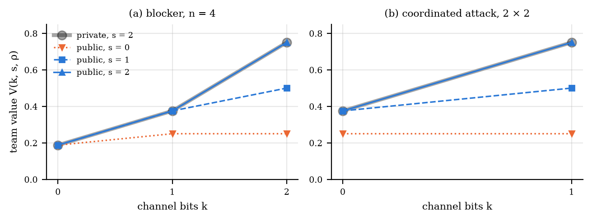
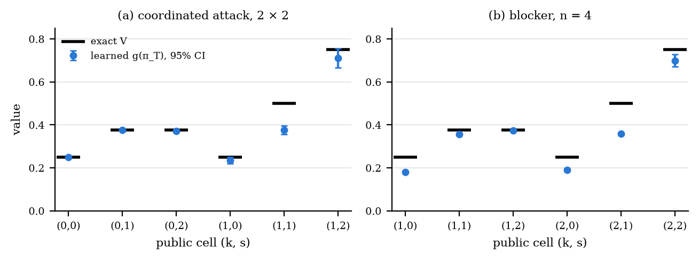
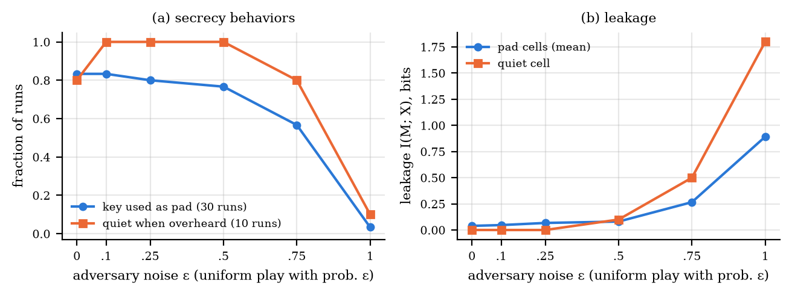
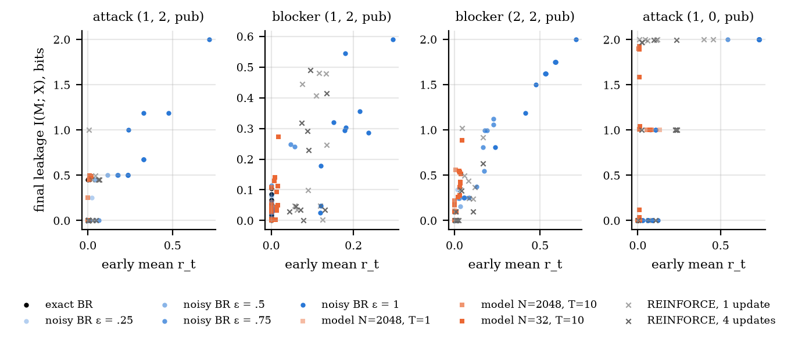
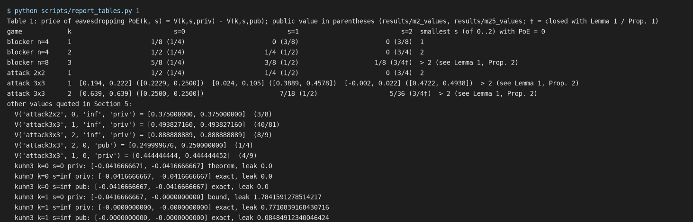
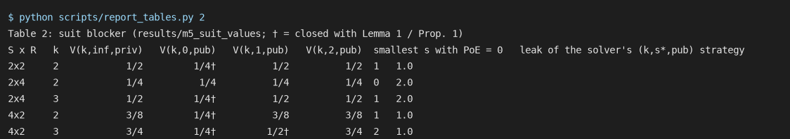
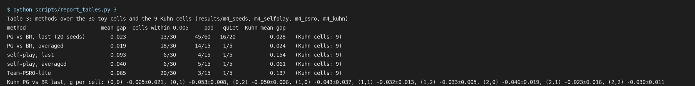

# How Many Bits Does a Team Need? Learning to Communicate Under Bandwidth and Secrecy Constraints in Adversarial Team Games

Course project, Foundations of AI (multi-agent systems), IIT Gandhinagar. Team: Anurag Singh, Abhishek Deepak Nair, Saujas Seth, Kaushal Mukund Rathi.

**Report:** [`report/main.pdf`](report/main.pdf) (source `report/main.tex`). Each number in it is traced to a results file and a command in [`report/NUMBERS.md`](report/NUMBERS.md).

Two teammates with different private information play a zero-sum game against an adversary. We give them a channel of `k` bits per round, which the adversary may overhear (`ρ = pub`) or not (`ρ = priv`), and `s` bits of shared secret key, and study the team's value `V(k, s, ρ)`.

The code has two parts:
- **Exact side.** It builds the augmented game `Γ(k, s, ρ)` on top of OpenSpiel and computes `V` exactly with solvers (column generation for `s = ∞`, global bilinear solves and pure-plan bounds for finite `s`). It also evaluates any team policy exactly: its guaranteed value `g(π_T)` against a best-responding adversary and its leakage `I(M; X)`.
- **Learning side.** It trains teams with reinforcement learning (tabular REINFORCE against an exact best response, self-play, Team-PSRO-lite, noisy and model-based adversaries, and neural policies). It then measures them against those exact values.

## Install

Python **3.11** is required because the OpenSpiel wheels need it. On Linux or macOS:

```
python3.11 -m venv .venv
.venv/bin/pip install -r requirements.txt        # OpenSpiel, NumPy, SciPy, PyYAML, Matplotlib, pytest, gurobipy, this package
```

With [uv](https://docs.astral.sh/uv/) the equivalent is `uv venv --python 3.11 .venv && uv pip install --python .venv/bin/python -r requirements.txt`. The package itself is defined in `pyproject.toml` (`pip install -e .`).

**Gurobi.**
- The exact solvers need a Gurobi licence (free academic licence: put `gurobi.lic` in your home directory, never in the repository). Without one they fall back to HiGHS through SciPy. That is fine for small cells but too slow for the larger ones.
- **You do not need Gurobi to check the report.** All exact values are cached in `results/`, and every learning experiment runs without Gurobi: learning code uses only the exact best-response evaluator, never the solvers.

## Quick check (about 5 minutes)

```
.venv/bin/python -m pytest -q -m "not slow" tests/        # with Gurobi: about 2 min, 351 passed, 14 deselected
                                                          # without a licence: about 14 min, 335 passed, 14 skipped
scripts/reproduce_report.sh                               # a few seconds: all tables and figures from results/
```

To reproduce a number from scratch, rerun the noisy-best-response experiment behind Figure 1 (240 training runs, about 2 minutes on 8 cores, no Gurobi):

```
.venv/bin/python scripts/run_m5.py --config configs/m5_dose.yaml
.venv/bin/python scripts/report_tables.py fig1
```

Training is deterministic given the config and the seed, so the output is exactly the committed one:

```
Figure 1 data (results/m5_dose): eps, pad / 30, quiet / 10, mean leakage on pad cells, quiet cell
  eps=0     pad 25/30  quiet  8/10  leak pad 0.04  leak quiet 0.00
  eps=0.1   pad 25/30  quiet 10/10  leak pad 0.05  leak quiet 0.00
  eps=0.25  pad 24/30  quiet 10/10  leak pad 0.07  leak quiet 0.00
  eps=0.5   pad 23/30  quiet 10/10  leak pad 0.08  leak quiet 0.10
  eps=0.75  pad 17/30  quiet  8/10  leak pad 0.27  leak quiet 0.50
  eps=1     pad  1/30  quiet  1/10  leak pad 0.89  leak quiet 1.80
```

These are the points of Figure 1 and the numbers in its paragraph in Section 6.2.

## Reproducing the report

`scripts/reproduce_report.sh` regenerates every table and figure from the cached results in a few seconds. `scripts/reproduce_report.sh --full` first reruns all learning experiments (about 3 hours on an 8-core laptop) and then regenerates them. The individual steps:

| report item | command (prefix `.venv/bin/python`) | run time (8-core laptop) | results folder |
|---|---|---|---|
| Table 1 (price of eavesdropping) | print: `scripts/report_tables.py 1`; recompute (Gurobi): `scripts/run_bounds.py --config configs/m2_values.yaml --seed 0` and `--config configs/m25_values.yaml --seed 0` | print: seconds; recompute: about 70 min + 3 h | `results/m2_values`, `results/m25_values` |
| Table 2 (suit blocker) | print: `scripts/report_tables.py 2`; recompute (Gurobi): `scripts/run_bounds.py --config configs/m5_suit_values.yaml` | print: seconds; recompute: about 40 min | `results/m5_suit_values` |
| Kuhn values (Section 5) | `scripts/run_values.py --config configs/m1_values.yaml --seed 0` (Gurobi) | about 20 min | `results/m1_values`, `results/m2_values` |
| Table 3 (methods) | `scripts/run_m4.py --config configs/m4_seeds.yaml`, then `m4_selfplay`, `m4_psro`, `m4_kuhn` the same way; print with `scripts/report_tables.py 3` | 3 + 2 + 3 + 2 min | `results/m4_seeds`, `m4_selfplay`, `m4_psro`, `m4_kuhn` |
| Table 4 (public cells) | as Table 3; `scripts/report_tables.py 4` | (in Table 3) | `results/m4_seeds` |
| Figure 1 (noisy best response) | `scripts/run_m5.py --config configs/m5_dose.yaml`; `scripts/make_report_figures.py` | 2 min | `results/m5_dose` → `report/figures/fig_dose.*` |
| Table 5 (training adversaries) | `scripts/run_m5.py --config configs/m5_model.yaml`, `m5_model_t1`, `m6_timescale`; `scripts/report_tables.py 5` | 5 + 2 + 5 min | `results/m5_model`, `m5_model_t1`, `m6_timescale` |
| Frozen-team diagnostic (Section 6.2) | `scripts/m6_adv_diag.py` (after `m6_timescale`) | 4 min | `results/m6_adv_diag` |
| Responsiveness (Section 6.2) | `scripts/run_m5.py --config configs/m8_resp.yaml`; `scripts/m8_analyze.py results/m8_resp/*/seeds` | 4 min | `results/m8_resp` → `report/figures/fig_responsiveness.*` |
| Curriculum, exact gradient (Section 6.1) | `scripts/run_m5.py --config configs/m5_curriculum.yaml`, `configs/m6_exactgrad.yaml` | 2 + 1 min | `results/m5_curriculum`, `results/m6_exactgrad` |
| Suit blocker learning (Section 6.2) | `scripts/run_m5.py --config configs/m5_suit.yaml` | 1 min | `results/m5_suit` |
| Scaling up (Section 6.3) | `scripts/m6_targets.py`; `scripts/run_m6.py --config configs/m6_neural.yaml`, then `m7_tabinit`, `m7_tabinit_long`, `m7_neural_diag`, `m7_neural_combo`, `m7_neural_gate` | 60 + 6 + 15 + 7 + 21 + 44 min | `results/m6_targets`, `m6_neural`, `m7_*` |
| Table 6 (settings and times) | configs above; times from `wall_seconds` in each `metrics.json` (`scripts/report_tables.py facts`) | seconds | all of the above |
| Extra figures (exact values, learning vs exact) | `scripts/make_report_figures.py` | seconds | `report/figures/` |

Every run writes `results/<experiment>/<config hash>/…` with its config, the git commit, the metrics and a summary table. The large per-run files (policies, curves) are not committed. Their seed-level numbers are kept in `runs.csv` next to each `metrics.json`.

## Results at a glance

Exact values against `k` (left: blocker game with 4 cards, right: coordinated attack on a 2 × 2 grid). With a public channel and no key the value is stuck at 1/4 (Lemma 1), and a short key lifts the cap to 1 − 2^−s.



Teams trained by policy gradient against an exact best response, on the 12 public cells (20 seeds, 95% CI), against the exact value:



Figure 1 of the report: secrecy survives a noisy adversary and collapses only when the adversary never reads the messages.



Responsiveness of the training adversary early in training against final leakage (400 runs, ten adversaries):



Terminal output of the table script for Tables 1 to 3:





## Repository layout

```
games/       card_guessing, card_blocker, suit_blocker, coordinated_attack, team_liars_dice (OpenSpiel games),
             augment.py (Γ → Γ(k, s, ρ): k-bit channel, s-bit key, visibility), merged.py (team as one player),
             tree.py (explicit sequence-form tree)
solvers/     backends.py (Gurobi, HiGHS fallback), seqform.py, tmecor_cg.py (V(k, ∞, ρ) by column generation),
             tmecor_enum.py (independent check), zero_sum_lp.py (V_Com), finite_s.py (finite s: bounds, bilinear)
eval/        best_response.py (exact g(π_T)), leakage.py (I(M; X)), sequence_form.py, perfect_recall.py,
             onestep.py (exact evaluation of the larger one-round games without building the tree)
learning/    tabular_pg.py (team REINFORCE vs exact BR, self-play, noisy and model adversaries, averaging,
             exact-gradient mode, responsiveness logging), psro.py (Team-PSRO-lite), neural_pg.py (MLP teams)
configs/     one YAML per experiment
scripts/     run_values.py, run_bounds.py (exact values); run_marl.py, run_m4.py, run_m5.py, run_m6.py (learning);
             report_tables.py, make_report_figures.py, render_screenshots.py, reproduce_report.sh (report);
             m6_targets.py, m6_adv_diag.py, m8_analyze.py, describe_learned_bit.py, export_runs_csv.py (analysis)
results/     cached results: config, metrics, summary and per-seed CSV of every experiment
report/      main.tex, main.pdf, figures/, NUMBERS.md
docs/        screenshots of the printed tables
tests/       sanity checks (known values, monotonicity, perfect recall, evaluator cross-checks, learners)
```

Solvers use at most `FAI_THREADS` threads (default 2), and `FAI_GUROBI_MEM_GB` caps Gurobi's memory. The learning runners use the `workers` count in each config, one thread per worker.
